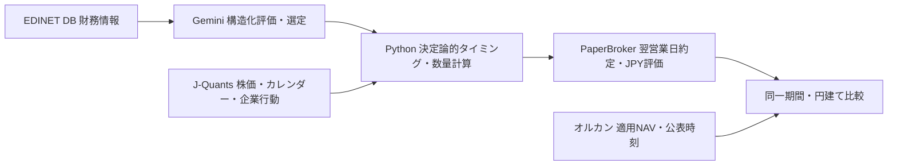

# AI vs オルカン：日本株研究の設計・ロードマップ

2026-10-21。今後の日本株開発は本書を基準とする。米国株のコード、診断Workflow、利用制限、既存口座は維持する。

## 比較の設計

独立した円建て仮想資金100万円を起点とする。AはGeminiによる財務評価・銘柄選定と決定論的スイング売買、Bは定量選定と同じ売買、CはGemini選定と定期リバランス、Dはオルカン一括保有。A−Bで選定、A−Cで売買タイミングの寄与を検討する。JP-1ではAのmock選定＋ルール売買とDの合成NAVだけを実行する。B/Cの比較効果は未検証。

AIは数量や約定価格を決めない。財務データには証券ID、発行体、会計期間、公表日時、取得日時、改訂版、出所、許可範囲を付与する。後日訂正を過去の判断へ遡及しない。過去時点の情報集合を復元できなければ、AI優位性の過去検証とは呼ばず、価格ルール検証と将来のAI判断ログを分ける。

## 段階と稼働条件

| 段階 | 内容 | 現在の境界・完了条件 |
|---|---|---|
| JP-0 | 設計・README・Pages | 日本株研究、実運用準備中、合成デモの分離 |
| JP-1 | 合成日本株MVP | 約20証券、JPY、100株、JPX、mock選定、翌営業日約定、合成NAV、全回帰CI |
| JP-2 | J-Quants Free読取研究 | 最新の無料仕様・遅延・内部保存・第三者送信・公開条件を公式資料で再確認。別承認後に接続 |
| JP-3 | EDINET DB Free財務 | 企業・証券対応、公表/取得/改訂、権利、理論株価モデルの利用制約を確認後に別承認 |
| JP-4 | Gemini財務評価 | 許可済み入力のみ。JSON検証、予算・無料枠、定量比較。送信は別承認 |
| JP-5 | 実データ仮想比較 | 品質・企業行動・実NAV適用日・コスト・公開権利を確認し、手動隔離口座から検証 |
| JP-6 | 日次継続仮想運用 | 排他・監視・復旧・予算・バックアップ確認後に定期起動を別承認。実資金は対象外 |

無料プランの名称・提供範囲・遅延（J-Quantsの直近12週制限を含む）は計画上の仮説であり、現行仕様の確約ではない。月額0円を優先し、有料契約・課金への自動移行を実装しない。EDINETのMCP対応はGemini APIへの転送許可を意味しない。理論株価モデルの禁止用途をランキング・推奨に転用しない。Gemini無料/有料の保持・学習条件は個別確認する。生データと派生成績の公開権利も別判定する。

## 再利用と安全境界

PaperBroker、Decimal台帳、コスト、リスク上限、JPXセッション、翌確定足、既存のトレンド/損切り/保有期間シグナルを再利用する。品質状態・証拠時刻は既存QualityAssessment/ReviewFactを利用する。US専用のNYSE/IEX証券登録簿やSwingDataを日本株へ偽装しない。JP-1の架空証券IDと架空ティッカーは専用生成器が管理する。

実ファンドNAV型は公式出所に限定されているため変更しない。JP-1の合成NAVは専用型で、1万口当たり・翌営業日適用・公表後にのみ評価可能という模擬契約を持つ。実ファンドの販売会社締切、申込不可日、外国休日、適用日・公表時刻はJP-5で別途確認する。合成NAVはオルカンの実績・推計ではない。

JP-1は新規一時SQLiteだけを用い終了時削除する。Supabase障害時の代替DBではない。実API、Gemini通信、既存口座、API履歴、永続化経路、cron、米国診断Workflowを変更しない。Pagesの日本株実運用欄は準備中固定とし、旧公開投影は過去の技術検証として明示操作した場合だけ表示する。

## 公平性・品質

100株単位、銘柄10%・株式80%・現金20%以上、手数料・スリッページを反映する。注文受付と約定は別処理。同日終値から同日始値へ約定させない。保有証券は選定落ちでも評価する。欠損・重複・未確定・35%超不連続・未対応企業行動・証拠不足で安全停止し、補完しない。母集団と証拠確認時点を保持する。現在ユニバースを歴史的投資可能集合とは呼ばない。

拡張時は20→200→2,000証券を合成負荷試験してから実APIの枠を試算する。JP-1のAPI呼出し数は0。AI mockの成績はAI能力・実市場利益の証拠にならない。
